# NaijaWatchTower

**Checkable text from polling-unit result sheets: read by a local model, checked by arithmetic, confirmed by the people who were there.**

> **UNOFFICIAL.** NaijaWatchTower is a proof of concept for the #AI4Elections Hackathon. It never declares results: only INEC declares official results. It has no integration with, approval from, or endorsement by INEC or any partner. The demo and every screenshot here use **clearly labelled simulated records** with fictional parties. Real result sheets were used only privately, to measure reading accuracy, and are never published.

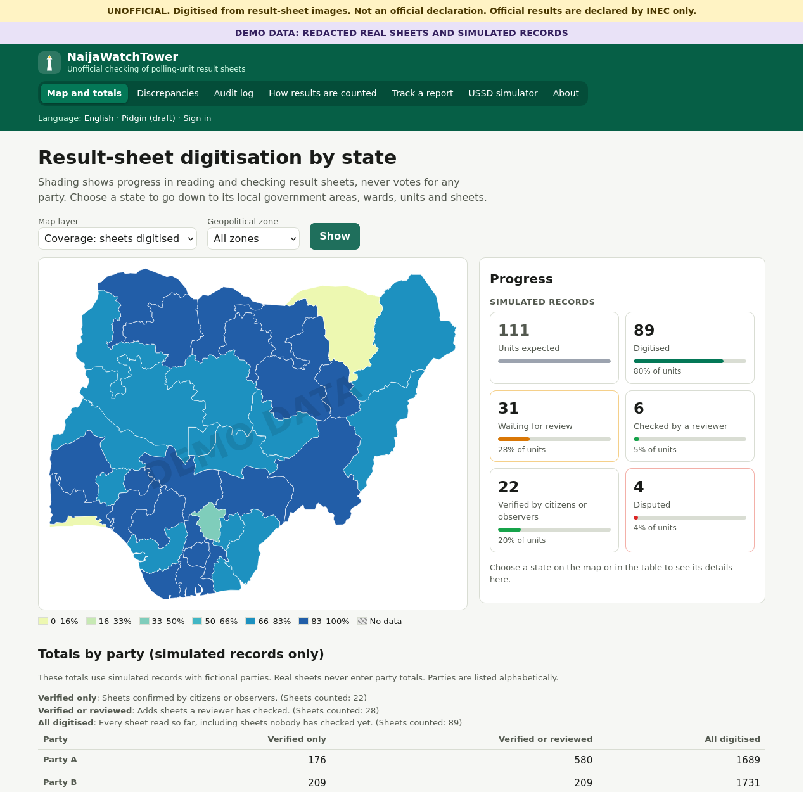

## What it does

After the count, every polling unit's result is handwritten on a Form EC 8A, posted at the unit and photographed. Those photos are public but hard to check at scale: they are images, many are blurred or skewed, and checking one means reading 27 handwritten numbers.

NaijaWatchTower:

1. **Reads each photo once** with an open-weight vision-language model on a single local GPU: 27 figures, each with a calibrated confidence. No image ever leaves the machine.
2. **Checks the arithmetic** the form itself implies (e.g. item 8 = items 5 + 6 + 7; party rows add up to total valid votes). When a check fails, it searches for the most probable reading that would add up and offers it to a reviewer as a **suggestion, never an automatic fix**.
3. **Routes every uncertain or inconsistent sheet to a person.**
4. **Lets citizens and accredited observers at that unit confirm or dispute** what was recorded, on the web or on **any basic phone via USSD**, with a tracked reference for every report.
5. **Shows progress on a national map** (digitised, verified, discrepancies, never votes for any party) with drill-down from state to LGA, ward, unit and sheet, every figure linked to its source image.
6. **Records every action in a hash-chained audit log** and exports discrepancies as a report, subject to INEC's written authorisation.

## See it without running it

All screenshots come from the demo (simulated records, fictional parties A–R). They can be regenerated with `scripts/make_screenshots.py`.

**1. The map shows progress, never votes.** Choose a layer: sheets digitised, share verified, open discrepancies or accreditation. Hatching means no data yet; each state is a link, with the same values in a table below the map.

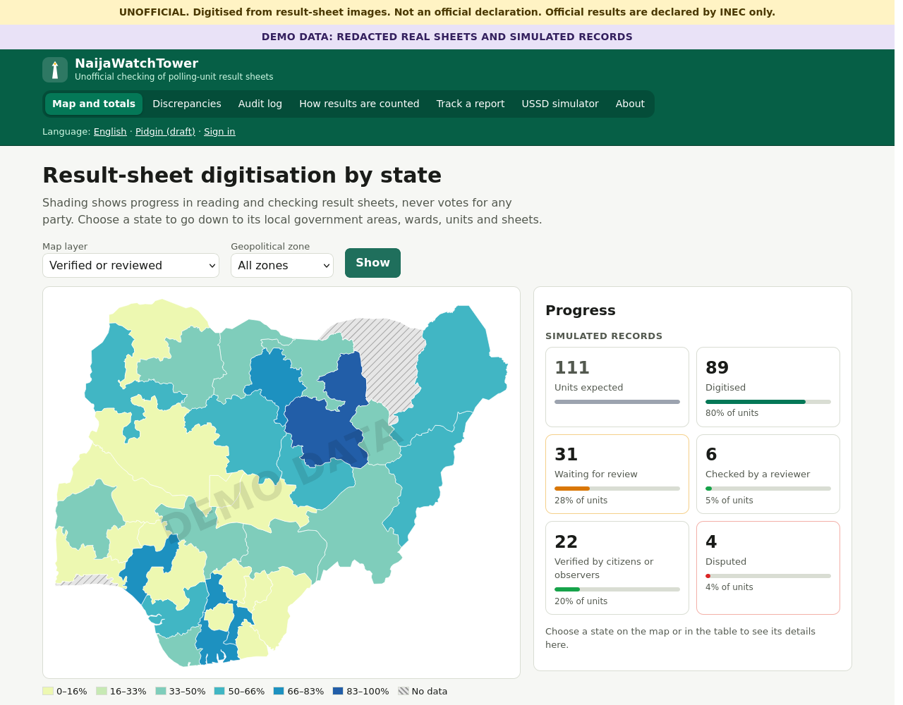

**2. Drill down from a state** to its local government areas, wards, polling units and sheets. Party totals appear only for simulated records, listed alphabetically and given three ways (verified only, reviewed, all digitised), never merged.

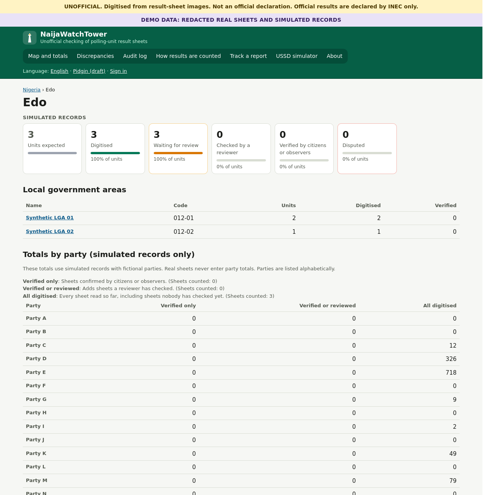

**3. Every sheet shows its figures, confidence, journey and arithmetic checks.** Each check is written out as an equation with the sheet's own figures (here item 7 says 726 but the party rows add up to 716). When the figures do not add up, the system searches for the most probable reading that would, and offers it to a reviewer as a *possible alternative reading*. It is never applied automatically.

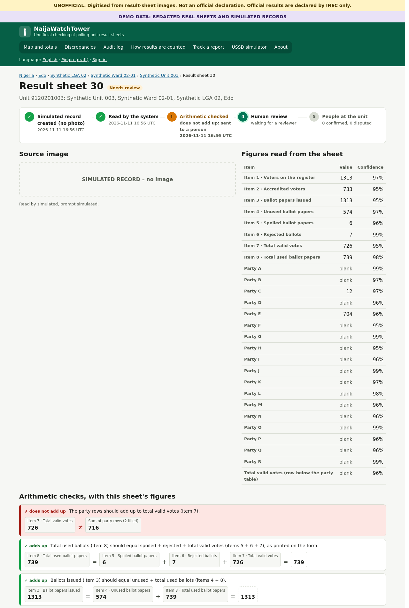

**4. People at the polling unit confirm or dispute** what was recorded, and can propose a corrected figure. Only counts are shown, never identities, and every report gets a reference number to track.

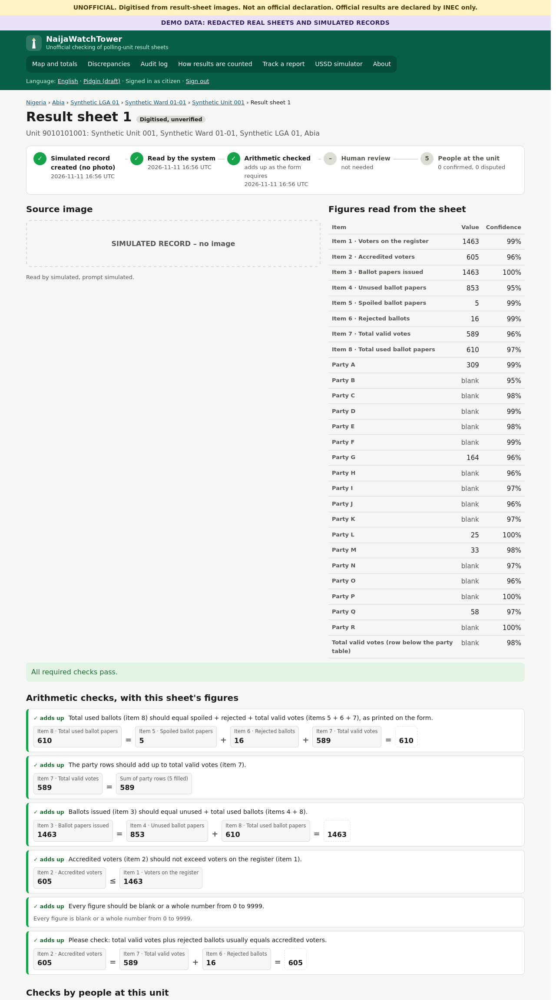

**5. On any basic phone via USSD**, without a smartphone or data: register to a unit, read its figures and confirm in a few key presses. These are the real screens produced by the USSD handler; every one fits 160 characters.

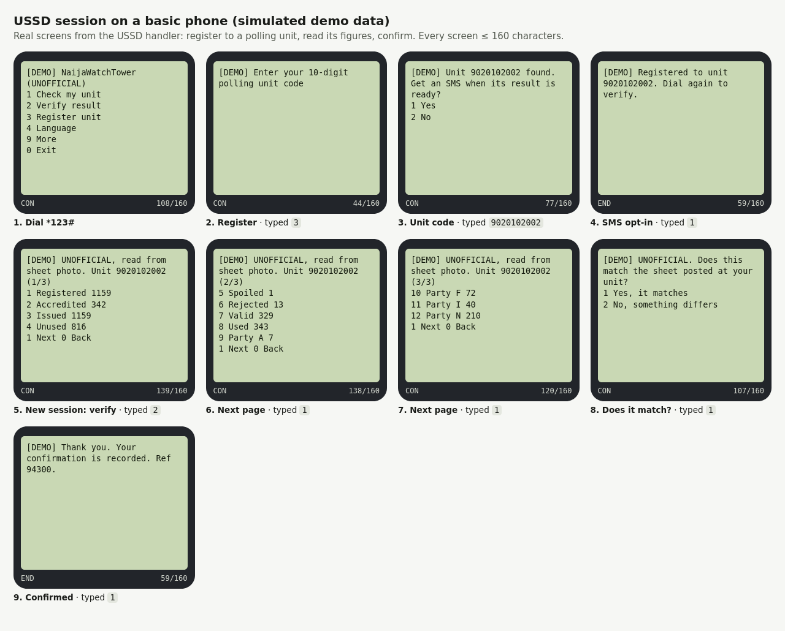

**6. Reviewers work through a queue sorted by risk.** Each card says why the sheet is there (a dispute, a check that fails, low-confidence or unclear fields) and the lowest field confidence. Reviewers must choose a reason for every decision.

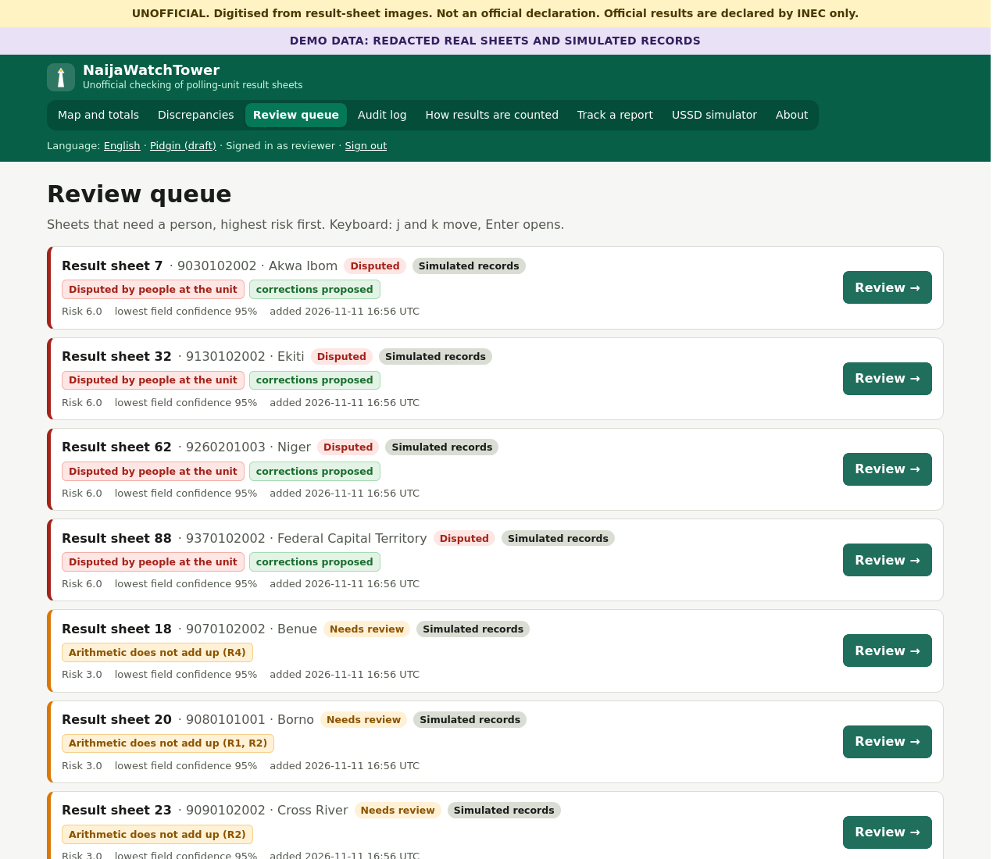

**7. Discrepancies are flags for human review, not accusations.** They can be filtered and exported as CSV or JSON, as a report subject to INEC's written authorisation.

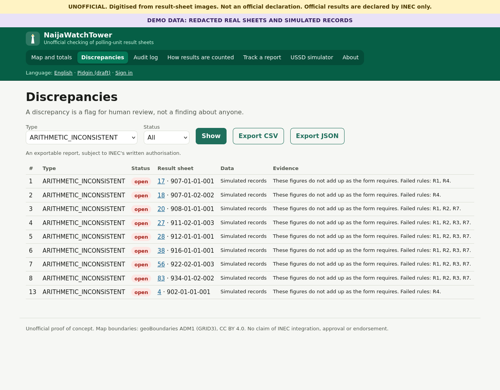

**8. Every action is hash-chained.** Each entry shows its own hash and the hash it follows, so any later edit to the log breaks every link after it.

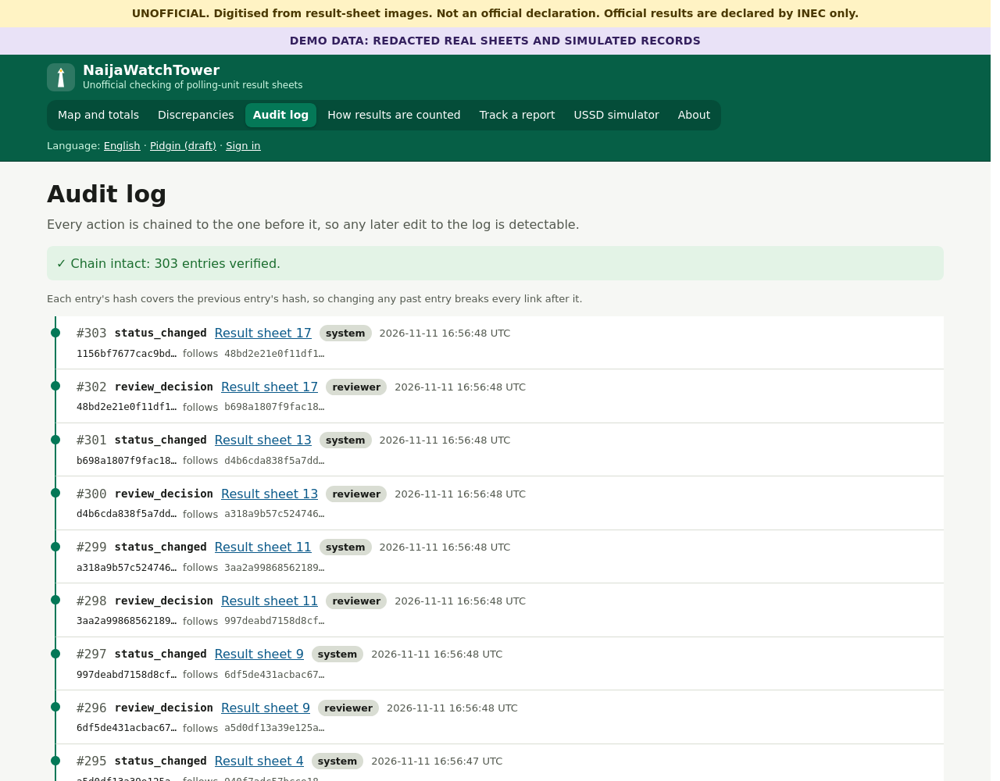

| **9. In Pidgin (draft)**, with English, and Hausa, Yoruba and Igbo files ready for translators | **10. On a phone browser** |
|---|---|
| 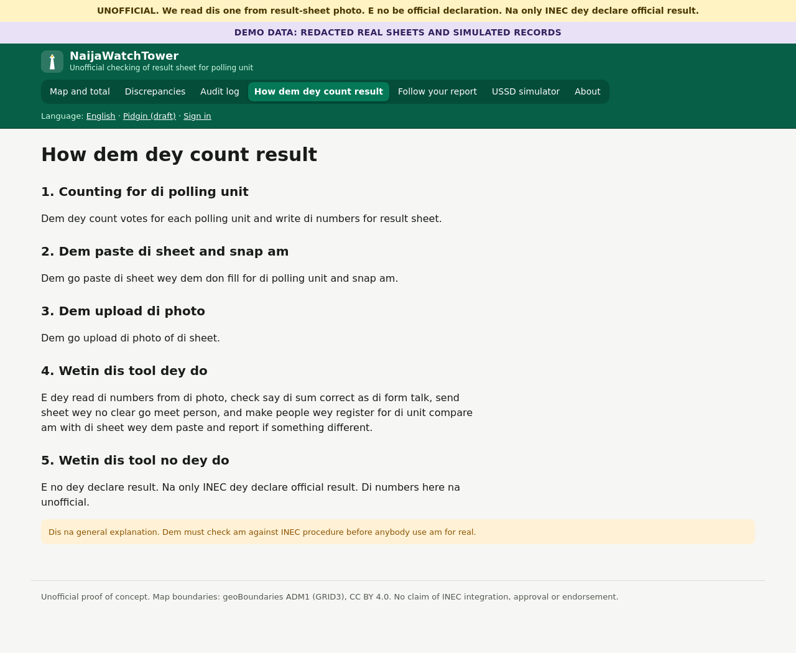 | 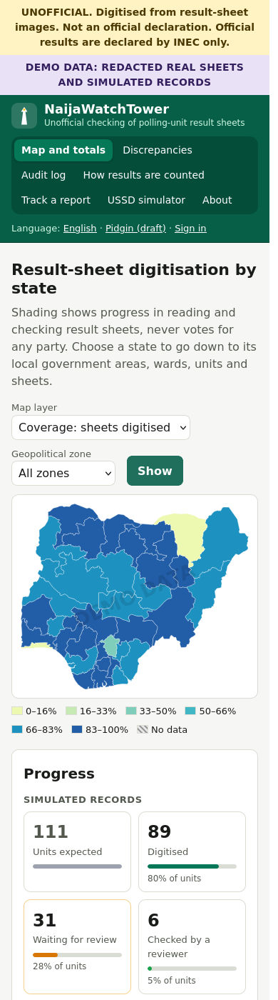 |

## Quickstart (no GPU needed)

```bash
make setup     # Python 3.12 venv via uv + CPU dependencies
make demo      # seeds the demo database and serves http://127.0.0.1:8000
```

Then **Sign in → Demo accounts** to act as a citizen, observer, reviewer or ingest operator; `/ussd-sim` is a phone simulator for the USSD channel. `make test` runs 88 tests without a GPU. The 3-minute walkthrough is in [`docs/DEMO_SCRIPT.md`](docs/DEMO_SCRIPT.md).

With an NVIDIA GPU (12 GB): `make setup-gpu`, then `make demo-live` reads newly uploaded sheets with the model.

## How it works

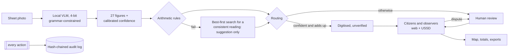

- **Constrained decoding.** The model never writes free text: the JSON keys are forced token by token and each value may only be digits or `null`. The output is always valid, and nothing written on a sheet can change its structure, which is a built-in defence against prompt injection.
- **Constraint-aware decoding** (the main technical contribution): when the figures do not add up, a best-first search over the model's alternative readings finds the most probable joint reading that does, changing at most 3 fields. A clear winner becomes a suggestion; close candidates are flagged as ambiguous; no consistent reading opens a discrepancy: *"These figures do not add up as the form requires."*
- More detail: [`docs/ARCHITECTURE.md`](docs/ARCHITECTURE.md).

## Results so far

Full tables with 95% bootstrap intervals: [`results/REPORT.md`](results/REPORT.md). Model details: [`docs/MODEL_CARD.md`](docs/MODEL_CARD.md).

> Caveats: 13 hand-labelled real sheets (R-dev 4, R-test 9), labels not yet reconciled, mostly 1024-pixel thumbnails. Intervals are wide and nothing here generalises to all sheets or elections.

| | Dataset (n) | Result |
|---|---|---|
| Field accuracy, shipped reader (Qwen3-VL-8B, zero-shot) | R-test (9 sheets) | **0.48** [0.34, 0.65]; 0.64 if an empty cell and a written 0 count as equal |
| Best other configuration (not selectable: chosen on R-dev only) | R-test (9 sheets) | Qwen3.5-9B 0.60 (0.83 blank = 0); 2-shot examples 0.70 |
| Valid output | all runs | 100% (constrained decoding) |
| Sheets accepted without a person | R-dev, R-test | **0%**: every sheet goes to review at the current accuracy |
| Planted arithmetic defects flagged (tampered digit, clerk's sum error, overvote) | 1,500 simulated records | 100%, with 0% false flags on 1,500 clean ones |
| USSD | all 342 reachable screens | ≤ 160 characters; checking a unit takes 1 key press, confirming a result 5 |
| Fake accounts needed to verify a wrong sheet | simulated unit | 3 without an observer; **impossible** with one honest observer present |

**Honest bottom line:** the reader is not yet accurate enough to work unattended (target 80% on non-blank R-dev fields; measured 49.5%). The system is built for exactly that situation: it sends every uncertain sheet to a person and lets the people who were there correct it.

## Inclusion

- **USSD for basic phones**: check your unit and confirm or dispute its figures without a smartphone or data, in English or **Pidgin (draft)**. Every screen fits 160 characters, including the `[DEMO]` tag.
- Hausa, Yoruba and Igbo translation files exist with every key, ready for native speakers (English is shown until filled).
- Web pages are server-rendered, work without JavaScript, are keyboard-navigable with visible focus, use a colour-blind-safe map scale with a text table beside it, and the map is about 20 KB gzipped for poor connections.

## Trust and participation

- **Result journey** on every sheet: uploaded → read → checked → reviewed → verified, with timestamps from the audit log.
- **Report tracking:** every dispute gets a reference; its public status and one-line reason (chosen from a controlled list) are visible without names or figures.
- **"How results are counted"** explainer on the web and over USSD.
- No turnout nudges, no targeting, the same content for everyone. The PoC measures nothing about trust or turnout; [`results/REPORT.md`](results/REPORT.md) proposes a pilot design.

## Security, privacy and responsible AI

- No voter cards, registers or biometrics. Phone numbers are stored only as salted HMAC hashes (tests grep the database and logs for raw numbers). Verifier identities are never shown, only counts.
- The model runs locally; no image goes to a hosted API; the raw model text is never stored.
- Real sheets: downloaded by hand from the public portal (no automated access), kept out of git, never shown except as **redacted copies** (solid boxes over names, signatures, codes and party names) once the organisers agree. Real party results never appear: party totals exist only for simulated records, because the party order is identical on every sheet.
- The map never colours or ranks by party; parties are alphabetical; wording tests forbid "winner", "leading", "fraud", "rigging" and turnout nudges.
- Details: [`docs/THREAT_MODEL.md`](docs/THREAT_MODEL.md), [`docs/PRIVACY.md`](docs/PRIVACY.md), [`docs/ASSUMPTIONS.md`](docs/ASSUMPTIONS.md) (every design decision and why).

## Limitations

- **Reading accuracy is low** on this small sample (see above); human review is mandatory.
- **A forger who edits all totals consistently is not caught by arithmetic checks.** That is what comparison with the posted sheet by citizens and observers is for.
- Citizen registration is self-declared and cannot prove presence at the unit: citizen checks are a signal, not proof, which is why observers weigh more.
- The arithmetic rules beyond the one printed on the form are logical inferences, validated on a small real sample only; they must be checked against INEC's form instructions before any real use.
- USSD needs a telecom aggregator, a shortcode and regulatory approval; none is connected. The SMS channel is a stub; nothing is sent.
- The "how results are counted" text is a general description to be checked against INEC's published procedures.

## Data and credits

- State boundaries: [geoBoundaries](https://www.geoboundaries.org) ADM1 for Nigeria (data from GRID3), **CC BY 4.0**, simplified for this project.
- HTMX 2.0.11 (0BSD), vendored. Models: Qwen3-VL-8B-Instruct and Qwen3.5-9B (Apache-2.0).
- Licence: MIT.
