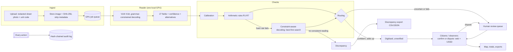

# Architecture

## Components

| Module | Role |
|---|---|
| `naijawatchtower/ocr/` | `SheetReader` interface; `VLMReader` (local GPU), `CacheReader` (replays stored readings by image hash), `FakeReader` (tests). `grammar.py` forces the JSON skeleton token by token so the model can emit only digits, `null` and field names; it also turns the per-step token probabilities into per-field confidence and up to six alternative readings. |
| `naijawatchtower/validate/` | `rules.py` (R1–R7 from `config/rules.yaml`), `decoding.py` (best-first search for the most probable joint reading that satisfies the hard rules, at most 3 fields changed, 50,000-node cap; a suggestion only), `routing.py` (AUTO_OK only when every calibrated confidence ≥ threshold, nothing unclear, and all hard rules pass). |
| `naijawatchtower/api/` | FastAPI app, SQLite via SQLAlchemy, single GPU worker thread, pipeline, verification/review/case services, audit chain, USSD state machine, translations. |
| `naijawatchtower/web/` | Jinja2 pages, vendored HTMX, server-rendered SVG map (geoBoundaries ADM1, CC BY 4.0). |
| `naijawatchtower/sim/` | Simulated records (numbers only, fictional parties) that fill states without real sheets. |
| `naijawatchtower/redact/` | Redacted display copies of real sheets (solid boxes, banner strip, metadata stripped). |
| `naijawatchtower/eval/` | Labelling tools, splits, metrics with bootstrap intervals, calibration. |

## Reading a sheet

1. The image is resized so it stays within the visual-token budget (`config/vlm.yaml: max_pixels`).
2. The prompt describes the form (8 numbered items, 18 party rows, bottom total) and the rules for blanks, corrections and written sums. Few-shot runs add labelled example sheets as earlier chat turns.
3. Decoding is greedy and **constrained**: the JSON keys are forced; at each value the model may emit only a digit, `null`, or the end of the number; the "unclear" list may hold only field names. Output is therefore always valid, and nothing written on a sheet can change its structure.
4. Field confidence = product of the probabilities of the tokens that decide the value, renormalised over the allowed tokens. Alternatives come from the top tokens at each position (substitutions, one digit shorter or longer, `null`).
5. Temperature scaling, fitted on the development sheets, calibrates confidence.

## Data model

`polling_unit`, `user`, `result_sheet`, `sheet_job`, `extracted_field` (model, repair suggestion and human-review values side by side), `validation_result`, `verification`, `correction`, `discrepancy`, `case_ref`, `sms_outbox`, `audit_log`. Real sheets sit under pseudonymous `8NN` unit codes, and simulated units under `9NN`. Real unit codes never enter the database.

## Running and scaling

- `make demo` runs everything on a CPU laptop from stored readings (`VLM_BACKEND=cache`). `make demo-live` loads the model on the GPU and reads newly uploaded sheets.
- One RTX 4070 (12 GB) reads a sheet in about 9–12 seconds in 4-bit at 6.8–8.2 GB peak VRAM, about 300–400 sheets per GPU-hour. The queue is one worker per GPU; adding GPUs means more workers on the same queue, and the rest of the system is stateless apart from the database.
- Nationwide scale (≈ 176,000 polling units) would need a few dozen GPUs over an evening, or batching, plus a production database. The reader is behind the `SheetReader` interface, so it can be swapped or fine-tuned on accepted corrections (`scripts/export_feedback.py`, field-level only) without touching the rest.
